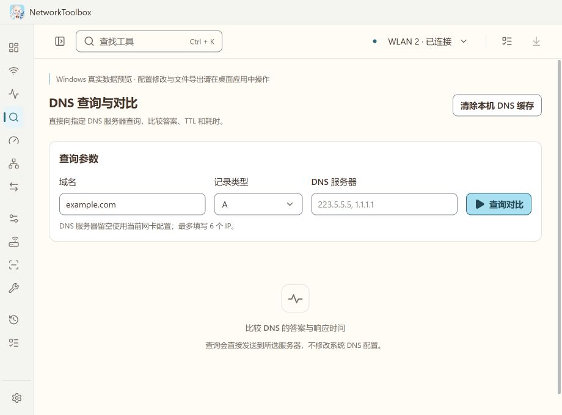

<p align="center"></p>

# NetworkToolbox

[English](./README.md) | 简体中文

用于 Windows 11 x64 的本地网络工具箱。提供无线信道可视化、连通性诊断、测速、设备发现、本机配置和小米路由器管理。界面为简体中文，支持深浅主题与系统托盘。

## 使用

[下载 Windows 版本](https://github.com/icelemon233/NetworkToolbox/releases/latest)。

此分支为 v0.2.2，目前已发布的安装包为 v0.2.0；使用新版界面需从源码构建。

- `NetworkToolbox-<版本>-Portable.exe`：直接运行，无需安装 Node.js 或 .NET。
- `NetworkToolbox-Setup-<版本>.exe`：安装版，可选择安装目录。
- 默认关闭窗口会进入托盘；v0.2.2 可在设置中改为关闭时退出。在应用设置或托盘菜单中选择“退出”可结束应用。

打开应用会读取本机连接和 Windows 缓存。附近热点主动扫描、外网测试、设备发现与后台监测均由用户手动开始。

## 工具

| 模块 | 已实现 |
| --- | --- |
| 网络总览 | 网卡、IPv4/IPv6 地址、DNS、网关、代理、协商速率、接口实时流量 |
| 无线信道 | 2.4/5 GHz 信道与广播频宽图、RSSI、接入点报告占用、候选信道、持续观察；6 GHz 依硬件能力显示表格 |
| 连通性 | 连续 Ping、丢包、相邻成功样本 RTT 差均值、P95、IPv4 路由追踪、TCP 端口、HTTP/TLS 与证书 |
| DNS | A/AAAA/CNAME/MX/NS/TXT/SOA，最多 6 个 UDP DNS 服务器对比、本机 DNS 缓存清理 |
| 测速 | Cloudflare 兼容外网下载/上传、HTTP 负载延迟、带临时密钥的局域网双端对测 |
| 局域网 | 当前私有 IPv4 网段发现、主机名、邻居缓存与 MAC、离线 IEEE 厂商线索 |
| 进程连接 | IPv4/IPv6 TCP 与 UDP 端点、PID、进程名、按需 ETW 进程上下行 |
| 本机配置 | IPv4/IPv6 DNS、IPv4 静态地址/DHCP、IPv4 MTU、用户代理/PAC、网卡开关、修改前快照恢复 |
| 小米管理 | AX3000T / RD03 / CN / 1.0.84：无线信道、频宽、SSID、强度；设备上网权限、限速、黑名单；DHCP、静态绑定、单端口转发、状态与重启 |
| 抓包 | Windows Packet Monitor、循环日志、pcapng 导出、以太网/IP/TCP/UDP/ARP 基础解析与记录筛选 |
| 其他 | 子网计算、Wake-on-LAN、公网 IPv4/IPv6 查询、路由表 |
| 历史 | 最多 500 条本地记录、快照比较、HTML 报告；手动停止和正常退出时保留任务的部分结果 |

## 读取与修改的边界



截图来自 Windows 只读预览，显示尚未开始检测的 DNS 查询界面。

新版 Windows 可能要求位置服务和桌面应用位置授权，才允许扫描附近 Wi-Fi。应用会报告被拒绝的情况，不能用管理员权限替代位置授权。

图中的频宽来自接入点广播。缺失值显示未知；未知频宽用虚线位置标记。信道建议只比较扫描到的重叠风险，不测量完整无线频谱噪声，也不保证换信道后更快。邻近接入点的占用率是它们的报告值。

无线主动扫描与 Ping 测量协调运行。网络工具提供异常证据，不将单个目标超时直接归因于路由器或运营商。路由追踪的星号也不等于该跳断网。

配置修改先生成预览。管理员操作通过有限的本机服务按需提权；应用主窗口正常运行。用户代理仅修改当前用户，不改 WinHTTP 的独立代理配置。

## 小米 AX3000T

在“小米路由器”中输入管理地址和管理密码。记住登录为可选项，使用 Windows 当前用户 DPAPI 保存。密码和会话令牌不返回界面、不写入普通历史和报告。

适配依据为同版本原厂模板。无线保存会合并两个频段的完整配置，保留未修改的密码；缺少可保留密码或信道枚举时拒绝提交。重复或过期预览不能重放，提交后需要回读确认。原厂 Web 接口可能随固件变化；其他版本可查看公开身份信息，修改保留原厂后台入口。

此构建已验证真实路由器的公开身份，登录和写入协议经过本地模拟服务测试。真实路由器的登录与修改还需要在应用中手动输入管理密码并验证。

## 本地数据

应用数据位于 `%APPDATA%\NetworkToolbox`。历史、捕获和受保护凭据分别保存；配置预览和恢复快照也由 Windows 当前用户加密保护。IEEE MA-L / MA-M / MA-S 厂商数据库随应用提供，不上传 MAC 地址；本地管理地址不会强行归属某个厂商。

普通历史和报告移除常见凭据字段、HTTP Cookie 与 URL 查询参数，仍可能包含网络名称、IP 和设备地址。抓包文件保留实际通信数据，只在用户选择导出时写到指定文件。

外网测速默认使用 `speed.cloudflare.com`；公网 IP 查询使用 ipify。所有这些请求只在手动点击时发起。局域网对测需要另一台电脑运行同版本工具箱，不兼容 iperf 协议。

## 开发

需要 Node.js 24、pnpm 11.25.0、.NET 10 SDK。运行 `scripts/build.ps1` 构建，附加 `-Package` 生成安装版和便携版；可用 `-Dotnet <路径>` 指定 SDK。

```powershell
pnpm install --frozen-lockfile
pnpm exec install-electron
pnpm lint
pnpm format:check
pnpm test
pnpm build
dotnet restore native/NetworkToolbox.Native.csproj --locked-mode
dotnet publish native/NetworkToolbox.Native.csproj -c Release --no-restore -o native/publish -p:DebugType=None -p:DebugSymbols=false
native/publish/NetworkToolbox.Native.exe --self-test
pnpm desktop
pnpm package
```

`node scripts/native-smoke.mjs` 检查真实 Windows 的只读采集及网关 Ping，不应用配置。`node scripts/preview.mjs` 提供同界面的本地数据预览，限制配置写入与提权。

接口边界见 [AGENTS.md](AGENTS.md)，路由器来源见 [docs/router-adapter.md](docs/router-adapter.md)。实际验证范围见 [docs/validation.md](docs/validation.md)。当前产物为本地未签名构建。
